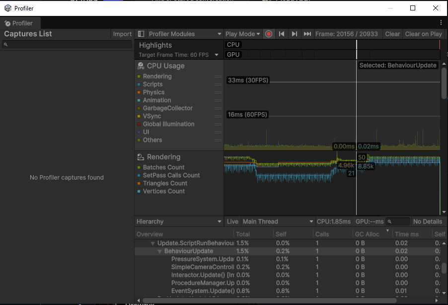
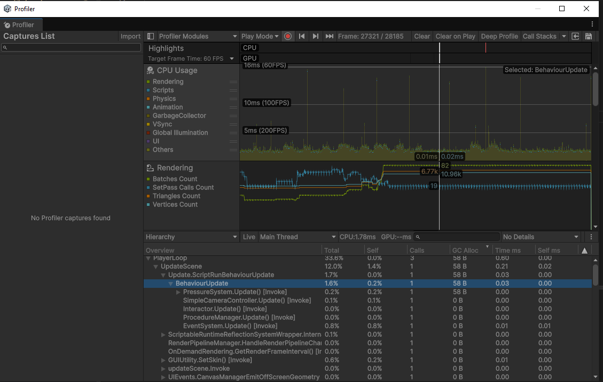
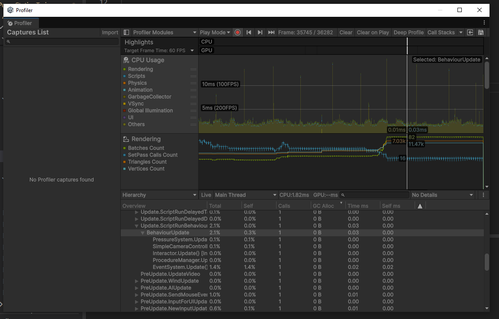

# Pump Station Maintenance Trainer

A small Unity virtual maintenance trainer, built in November 2026 to learn C# and Unity. A trainee follows a guided, step-by-step procedure to replace a clogged hydraulic filter on a pump station, with mistake detection and an end-of-run summary.

## The procedure

1. Open the access panel
2. Close the supply valve
3. Wait for system pressure to bleed off
4. Remove the clogged filter
5. Install the new filter
6. Reopen the valve and confirm pressure is restored

The current instruction and a live checklist are shown on screen. Removing the filter while the system is still pressurized triggers a warning and a spark effect, and the run ends with a summary of total time, mistakes made and the slowest step.

## How to run

**Unity trainer:** open `PumpStationTrainer_Unity` in Unity Hub (Unity 6.3 LTS), load the scene, press Play.
Hold right mouse to look, WASD to move, left-click to interact (valves, the access panel, filters). Click a held filter to drop it.

**Console model** (requires the .NET SDK):

```
cd PumpSimConsole
dotnet run
```

## Design process

I didn't start in Unity. The project was built in planned stages, each one tested before moving on:

1. **Requirements first.** I broke the trainer into what it needed to do: interactable parts, a pressure simulation, an ordered procedure whose steps check the state of the world, mistake detection, and feedback for the trainee.
2. **Model the logic in plain C#.** A console app (`PumpSimConsole/`) let me get the object model right without the engine in the way: an abstract `Component` hierarchy, interfaces for capabilities, and events between systems.
3. **Design the Unity architecture.** Before writing scripts, I decided on the key structures: an `IInteractable` interface so one click handler works on anything clickable; procedure steps as **ScriptableObject data**, so a new procedure could be built without code; and a `ProcedureContext` so those data assets can reach scene objects.
4. **Implement milestone by milestone.** Interaction → procedure system → physics and polish → profiling and refactoring, committing working progress at each step.

| Milestone                                                                         | Status |
| --------------------------------------------------------------------------------- | ------ |
| 0 · Setup (Unity 6.3 LTS, .NET, Git)                                              | ✅     |
| 1 · Pure C# model (console app)                                                   | ✅     |
| 2 · Unity interaction: clickable valve, event-driven gauge, prefabs               | ✅     |
| 3 · Procedure system: ScriptableObject steps, UI, mistake detection               | ✅     |
| 4 · Physics and polish: kinematic door, grabbable filters, socket, object pooling | ✅     |
| 5 · Profiling, debugging, event-driven refactor                                   | ✅     |

## Architecture

**Interaction**

- `IInteractable` defines what anything clickable must have (`Prompt`, `CanInteract`, `Interact()`). `InteractableBase` is an abstract `MonoBehaviour` implementing it, with `virtual` defaults and an `abstract Interact()`.
- `Valve`, `Door` and `Grabbable` inherit `InteractableBase` and override `Prompt` and `Interact()`.
- `Interactor` raycasts from the camera, filtered by an `Interactable` layer mask, and finds targets with `GetComponentInParent<IInteractable>()`, so it works with any interactable, even when the collider sits on a child object.

**Simulation**

- `PressureSystem` moves pressure toward 3000 PSI or 0 depending on the supply valve (`Mathf.MoveTowards`, `Time.deltaTime`) and raises `OnPressureChanged` **only when the value actually changes**.
- `Gauge` subscribes in `OnEnable` / unsubscribes in `OnDisable` and maps PSI to a needle angle (`Clamp01` + `Lerp`), with an initial sync in `Start`.
- `FilterSocket` is a trigger collider that installs the correct part through guard clauses, holds it by reference (composition, not inheritance), and subscribes to its `OnPickedUp` on insert / unsubscribes on removal.

**Physics**

- `Door` is a **kinematic** Rigidbody: `Interact()` only flips its target state, and `FixedUpdate()` rotates it with `MoveRotation` + `RotateTowards`, keeping it in sync with physics.
- `Grabbable` filters are **non-kinematic** when loose (they fall) and **kinematic** when held or installed. `PickUp`, `Drop` and `LockInto` each set the state they create, sharing an `Attach` helper.

**Procedure**

- `TrainingStep` is an abstract `ScriptableObject` with `abstract bool IsComplete(ProcedureContext ctx)`. `DoorOpenStep`, `ValveStateStep`, `PressureBelowStep` and `PartInSocketStep` each override it, and each step is an asset. One class can serve several steps with different data: `PartInSocketStep` with an empty id means "socket must be empty," and with `new-filter` means "new filter installed."
- `ProcedureContext` lives in the scene and gives step assets access to scene objects (assets can't reference them directly): the pressure system, the door, the socket, and a `Dictionary<string, Valve>` built with LINQ `ToDictionary`, with a clear error for unknown ids.
- `ProcedureManager` runs the steps polymorphically, times each one, and raises `OnStepStarted` / `OnProcedureComplete`. It's **fully event-driven**: it re-checks the current step only when a valve, the pressure, the door or the socket changes, with no per-frame polling. Its state is exposed read-only (`IReadOnlyList`, get-only properties).
- `MistakeTracker` is a second, independent listener on the old filter's `OnPickedUp` and raises `OnMistake` if the system is still pressurized.

**UI and effects**

- `ProcedureUI` is event-driven: instruction, a checklist rebuilt with `StringBuilder`, warnings, and a LINQ summary (`Sum`, `Max`, `IndexOf`). Layout uses a Canvas Scaler, anchors and background panels.
- `SparkEffects` reuses effects from Unity's `ObjectPool<T>` instead of `Instantiate`/`Destroy`, with a coroutine returning each one to the pool when it finishes.

**Console model (`PumpSimConsole/`)**

Abstract `Component` with `Pump`, `Valve` and `Filter`; `IInspectable` / `IRepairable` interfaces; events (`Valve.OnToggled` with two independent listeners); a static `Units` class; a LINQ report; a reflection-based `DebugReport` that prints any property tagged with a custom `[ShowInDebug]` attribute; and an interactive menu.

## Profiling and refactoring

**Profiler pass:** every script allocates **0 B per frame** (CPU module → Hierarchy, sorted by GC Alloc). To practice finding garbage, I added a string concatenation inside `PressureSystem.Update()`: the Profiler showed **58 B every frame**, which I traced down the Hierarchy to the method, removed, and verified.

| Before                              | Introduced garbage                    | After                             |
| ----------------------------------- | ------------------------------------- | --------------------------------- |
|  |  |  |

**Memory-leak investigation:** I deliberately subscribed a listener to a **static** event without unsubscribing, then reloaded the scene repeatedly. Each reload left a dead subscriber that could never be freed (confirmed with Memory Profiler snapshots) and that threw `MissingReferenceException` when the event fired. Fixed by unsubscribing in `OnDisable()`.

**Polling → events refactor:** `ProcedureManager` originally checked the current step every frame in `Update()`. That was simple and got the procedure working first. Once everything worked, I refactored it to subscribe to the four state-change events instead, so it does no work while nothing changes and isn't tied to frame timing. Behavior stayed identical, and it disappears from the Profiler's per-frame list.

## Bugs found and fixed

Detailed write-ups (symptom, how I found it, cause, fix, lesson) are in [BUGLOG.md](BUGLOG.md). Highlights:

- **Memory leak from a static event:** listeners that never unsubscribed survived scene reloads. Fixed with `OnDisable` unsubscribe.
- **Listeners subscribing more than once:** setup code inside a loop subscribed new listeners on every pass. Moved it outside.
- **Gauge needle jumping on startup:** an event-only display had no initial value. Added a sync in `Start()`, which runs after every `Awake()`.
- **Scene changes missing from the repo:** unsaved scene and asset changes never reached Git. Now I save the scene and project before every commit.
- **New filter vanishing when picked up:** prefabs can't keep references to scene objects. Set the reference on the instance.
- **Sparks never returning to the pool:** a looping particle system never reports itself finished. Switched to a single burst.
- **Repo setup:** the Unity `.gitignore` template ignored the console project's `.csproj`, build output (`bin/`, `obj/`) had been committed, and Unity Hub had created a nested Git repo. Fixed all three.

## Project structure

```
PumpSimConsole/
├── Program.cs
├── Components/     Component, Pump, Valve, Filter
├── Interfaces/     IInspectable, IRepairable
├── Systems/        PressureSystem, ValveLogger
└── Utilities/      Units, Reports, DebugReport, ShowInDebugAttribute

PumpStationTrainer_Unity/.../Assets/
├── Scripts/
│   ├── Core/          ShowInDebugAttribute, IInteractable, InteractableBase
│   ├── Interaction/   Valve, Interactor, Door, Grabbable
│   ├── Player/        SimpleCameraController
│   ├── Simulation/    PressureSystem, Gauge, FilterSocket
│   ├── Procedure/     ProcedureContext, TrainingStep, ValveStateStep, PressureBelowStep,
│   │                  DoorOpenStep, PartInSocketStep, ProcedureManager, MistakeTracker
│   ├── UI/            ProcedureUI
│   ├── Effects/       SparkEffects
│   └── Debugging/     LeakyListener, SceneReloader
├── Prefabs/           Valve, Gauge, Filter, Sparks
├── Steps/             01_OpenPanel … 06_ReopenValve
└── Materials/
```

## What I'd do next

- Load procedures from external data (e.g. JSON), so trainers can be authored without opening Unity
- More mistake types (wrong order, wrong part) and per-step hints
- Make the drain valve affect how fast pressure bleeds off
- Save and replay a trainee's session for instructor review
- Unit tests for step logic and the procedure manager
